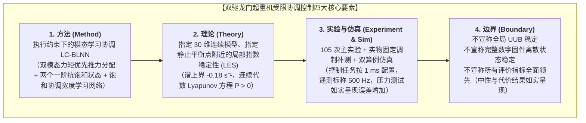

# 双驱龙门起重机控制系统论文撰写最终事实清单与总入口 (Final Source of Truth & Thesis Portal) - 规范终版

本目录（`D:\lunwen2\all\all`）为论文写作的**唯一权威基准材料库**。此前分散在各测试目录中的探索性脚本、临时验证记录及已被推翻的旧版假设已全部移出写作入口。后续毕业论文各章节的撰写、图表排版与数据引用，均以本目录中的文件为唯一事实依据。

---

## 一、核心事实与主张四要素 (The Four Invariable Pillars)

论文在方法、理论、实验与陈述边界上必须严格遵循以下四项核心事实，不扩充、不泛化：



### 1. 方法 (Method)
- **控制构型**：采用**执行约束下的模态学习协调 LC-BLNN（Learning-Coordinated Broad Learning Neural Network / Broad Learning System）**。
- **架构组成**：
  1. 双模态力矩优先推力分配器（解耦双侧同步带驱动的平动推力与偏转力矩，优先保障偏转安全，单侧电流限幅 $\le 800\,\text{counts} / 4.96\,\text{N}$）；
  2. 两个一阶抗饱和状态动态（状态耗散衰减率 $\lambda_{\rm aw} = 20.0\,\text{s}^{-1}$，反馈增益 $K_{\rm aw} = 20.0\,\text{s}^{-1}$）；
  3. 执行差异驱动的学习协调调制因子 $\rho = \frac{1}{1 + \gamma_{\rm lc} (\delta / U)^2}$，在推力饱和时动态降低更新增益，抑制宽度学习网络权重过度增长；
  4. 基础 C2b 滑模控制器提供基准动力学逆解与鲁棒跟踪。

### 2. 理论 (Theory)
- **理论定理**：  
  > **在所列假设参数及连续模型下，所考察的两个静止平衡点经数值线性化核查，具有局部指数稳定性；受限运动过程的性能由所建模型仿真与重复实物对照评价。**
- **模型依据**：基于建立的 **30 维连续闭环系统**（机械位移与速度误差 4 维、两个一阶抗饱和状态 2 维、双通道自适应宽度学习网络权重 24 维）。
- **核查证据**：
  - 名义平衡点（$d_{\rm ext}=0$）与现实定常偏置平衡点（$d_{\rm ext}=[0.5\,\text{N}, 0.2\,\text{N}\cdot\text{m}]$）均严格位于分配器线性无饱和分支内部；
  - 30 阶雅可比矩阵全部特征值实部严格为负（严格 Hurwitz），谱上界恒为 $\lambda_{\rm dominant} = -0.180000\,\text{s}^{-1}$（由偏转神经元正则化率 $-\varepsilon_\alpha \eta_\alpha$ 主导）；
  - 连续代数 Lyapunov 方程 $A^\top P + P A = -I_{30}$ 存在唯一对称正定解 $P > 0$（残差 $\sim 10^{-8}$）；
  - 步长敏感性检验（$10^{-6}, 10^{-7}, 10^{-8}$）证实谱上界高度稳定。

### 3. 实验与仿真 (Experiment & Simulation)
- **实物实验规模与时序机制**：
  - 物理实验平台完成 **35 个配对块、共 105 次正式主实验**（M1 基准滑模、M2 普通 BLNN、M3 本文 LC-BLNN 每组各 35 次完全独立运行），全量无抽样保留；
  - **控制时序与遥测机制**：控制算法在 `motor_task` 中通过任务延时调度执行，**控制任务按 1 ms 周期配置**；上位机通过 DMA 高速遥测接收记录，**遥测标称 500 Hz，存在丢帧导致的较大时间间隔**；每次时域机动记录时长约 22 秒，产生约 11,000 行遥测记录（通常为 10,997 ~ 11,000 点）；
  - **核心统计**：
    * **权值峰值**：LC-BLNN 相比普通 BLNN **显著降低了观测权值峰值**（均值从 $1.5590$ 降至 $0.6303$），配对差值 $-0.9287$，$t = -3.135,\;p = 0.0035 < 0.01$，Wilcoxon $p = 0.0015 < 0.01$，胜率 $25/35$（$71.4\%$）；
    * **同步精度**：同步误差 RMS 从 $0.0865\,\text{mm}$ 降至 $0.0794\,\text{mm}$（改善 $8.2\%$），Wilcoxon 非参数检验差异显著（$W = 195.0,\;p = 0.0495 < 0.05$），配对 $t$ 检验呈现改善趋势（$t = -1.843,\;p = 0.0740$），胜率 $26/35$（$74.3\%$）；
    * **硬件耗时**：单步控制仅耗时 $45.59\,\mu\text{s}$，占 $1\,\text{ms}$ 控制周期的 $4.56\%$。
- **实物固定调制对照补测**：
  - 在真实实验台上完成了 2 个独立配对 Block（P01 与 P02，共 6 次实机运行）的固定调制对照补测（配置 $\rho_{\rm fixed} = [0.917, 0.979]$），直接索引见 [补测配对结果](06_实物补测_探索性/paired_comparisons.json) 与 [`all_attempts.csv`](06_实物补测_探索性/all_attempts.csv)；
  - 实测显示 LC 相比 Fixed 在跟踪 RMSE 上呈现改善优势（均值差 $-0.0772\,\text{mm}$，2/2 优势，LC 均值 $0.2809\,\text{mm}$ vs Fixed $0.3581\,\text{mm}$），权值峰值均值差 $-0.1210$。
- **仿真算例体系**（对象质量统一为实测 $3.0\,\text{kg}$，含右轨阻尼 20% 不对称设计摄动）：
  - **算例 A（50 mm 深饱和压力测试）**：严重受限工况下（饱和率 87.0% ~ 99.6%），**本算例中，LC降低了观测权值峰值（从 76.49 降至 5.84），同时跟踪与同步误差有所增加（跟踪 RMSE 从 23.82 mm 增至 25.04 mm，同步 RMS 从 0.00098 mm 增至 0.00124 mm）**；
  - **算例 B（10 mm 受限工况对照）**：轻中度受限工况下（饱和率约 22.8%, 最小 $\rho_y = 0.1893$），LC-BLNN 将权值峰值从 3.065 抑制到 1.043 (-66.0%)，且跟踪 RMSE 从 0.602 mm 微优至 0.573 mm，同步 RMS 维持在 0.00068 mm 极高水准；
  - **历史消融算例**：离线固定调制仿真（`run_offline_fixed_modulation_benchmark.py`）仅作为算法探索记录，明确区分于实物平台补测与诊断测试。

### 4. 边界 (Boundary)
- **不宣称全局 UUB**：不宣称闭环系统在大范围运动空间或连续全扰动域内存在全局/半全局一致最终有界（UUB）；受限运动过程中的瞬态性能由实物对照与仿真评价；
- **不宣称数字固件离散全状态稳定**：连续模型证明中针对静态平衡点进行了合理简化（省略了高阶加速度观测器暂态动态、变化率限制器的离散历史状态与 ZOH 离散效应），稳定性结论严格限定于**所建立的 30 维连续模型**；
- **不宣称所有指标全面领先**：客观陈述实验中中性或未达到统计显著性的指标（如实物峰值同步误差与跟踪误差，双检验 $p > 0.1$，两算法表现相近），如实报告不选汰；
- **不宣称“消除发散”**：有限样本实验中观测权值峰值的下降，客观定性为“显著降低了观测权值峰值”，不外推为理论上消除了数学发散。

---

## 二、材料目录结构与文件溯源入口

本目录划分为 5 个职责明确的子文件夹：

```text
D:\lunwen2\all\all\
├── 00_写作入口与来源清单\
│   ├── 00_论文写作事实清单与终版入口.md          <-- 本总入口文件
│   └── file_manifest_and_hashes.json          <-- 全量文件哈希与溯源清单
├── 01_理论分析与连续模型\
│   ├── continuous_closed_loop_model.py        <-- 30维连续闭环系统分析母模型
│   ├── frozen_request_fast_subsystem.py       <-- 冻结请求快子系统指数收缩分析
│   ├── frozen_request_fast_results.json       <-- 快子系统解析平衡点验证结果
│   ├── time_varying_request_fast_subsystem.py <-- 时变请求快子系统ISS输入界推导
│   ├── time_varying_request_fast_results.json <-- Lipschitz界(1/√2)与ISS验证
│   ├── local_linearization_stability_analysis.py <-- 局部线性化稳定性分析定稿脚本
│   └── local_linearization_stability_results.json <-- 平衡点、雅可比全谱、Lyapunov解
├── 02_仿真与控制配置\
│   ├── config_e5_final.py                     <-- 最终仿真配置 (统一 m_G = 3.0 kg, 右轨阻尼+20%不对称)
│   ├── controller_e5_final_lc.py              <-- LC-BLNN 控制器仿真实现
│   ├── run_unified_saturation_benchmark.py    <-- 统一受限饱和基准仿真执行脚本
│   ├── EXP5_UNIFIED_SATURATION_BENCHMARK.csv  <-- 统一仿真基准指标对比数据 (算例A与算例B)
│   ├── EXP5_UNIFIED_SATURATION_COMPARISON.png <-- 统一仿真对比曲线图 (深饱和权值抑制)
│   ├── EXP5_SIMULATION_EXPLANATION.md         <-- 仿真算例体系与证据链说明文档
│   ├── run_offline_fixed_modulation_benchmark.py <-- 历史固定调制离线消融脚本
│   ├── EXP5_OFFLINE_FIXED_MODULATION_BENCHMARK.csv <-- 历史固定调制离线数据
│   └── EXP5_OFFLINE_FIXED_MODULATION_COMPARISON.png <-- 历史固定调制对比图
├── 03_实物实验统计与图表\
│   ├── EXP5_TABLE1_FINAL_SUMMARY_STATISTICS.csv <-- 论文表1：105次实验总统计
│   ├── EXP5_TABLE2_PAIRED_DIFFERENCES_AND_TESTS.csv <-- 论文表2：35组配对双检验
│   ├── EXP5_TABLE3_DATA_QUALITY_AUDIT.csv     <-- 实验数据质量与遥测丢帧审计
│   ├── EXP5_35BLOCKS_105TRIALS_COMPREHENSIVE_ANALYSIS.png <-- 105次实验总分析图
│   ├── EXP5_35BLOCKS_105TRIALS_TRAJECTORY_PROFILES.png <-- 误差轨迹轮廓图
│   ├── EXP5_35BLOCKS_DISTRIBUTION_AND_PAIRED_DIFFERENCES.png <-- 分布与配对差值图
│   ├── EXP5_35BLOCKS_REPRESENTATIVE_TIME_SERIES.png <-- 代表性时域响应曲线
│   ├── EXP5_MECHANISM_DISCREPANCY_TO_RHO_VERIFICATION.png <-- 执行差异到rho机制图
│   ├── EXP5_MECHANISM_ANALYSIS_REPORT.md      <-- 机制深入分析详细报告
│   ├── audit_lc_mechanism.py                  <-- 机制统计与指标提取脚本
│   └── plot_mechanism_analysis.py             <-- 论文图表绘图主脚本
├── 04_参数身份与对应关系\
│   ├── parameter_identity_and_mismatch_ledger.md   <-- 三类质量参数身份客观界定报告
│   └── parameter_identity_and_mismatch_ledger.json <-- 参数与失配比结构化底册
└── 05_正式固件与原始数据索引\
    ├── firmware\                              <-- 嵌入式正式固件源码副本
    │   ├── experiment5_config.h               <-- 第5次实验正式参数配置文件 (motor_task 1 ms 配置)
    │   ├── controller_e5_blnn_lc.c            <-- 嵌入式控制算法核心C源码
    │   └── experiment3_config.h               <-- 12.445 kg 历史来源出处
    └── raw_experiment_data_index.md           <-- 105次主实验与实物补测索引 (遥测标称 500 Hz，存在丢帧间隔)
```

---

## 三、论文各章节撰写数据与图表索引表

| 论文章节 | 建议标题与核心主题 | 建议引用的图表与文件 | 核心论述要点与论据约束 |
|---|---|---|---|
| **第 3 章** | **双驱龙门起重机受限建模与推力分配** | - 图 3-x: 双驱同步带传动拓扑与双轴扭转模型<br>- 表 3-1: 物理假设参数与控制器名义参数对照表（引自 `04/parameter_identity_and_mismatch_ledger.md`）<br>- 代码: `02/config_e5_final.py` 与固件 `05/firmware/experiment5_config.h` | 1. 明确双侧为同步带传动，列明 3.0 kg 实测台车机械质量与 12.445 kg 控制器名义模型系数的客观来源（前期第 3 次实验设定值沿用，4.15倍失配），阐明引入自适应的必要性；<br>2. 建立双模态力矩优先分配器模型，给出偏转力矩优先保障机制与单侧 800 counts / 4.96 N 限幅。 |
| **第 4 章** | **自适应学习协调控制器设计与局部稳定性分析** | - 式 (4-x): 基础滑模 + 两个一阶抗饱和状态 + BLNN 学习协调调制律<br>- 定理 4-1: 快子系统时变 ISS 稳定性定理（引自 `01/time_varying_request_fast_results.json`）<br>- 定理 4-2: 连续闭环模型静止平衡点的局部指数稳定性定理<br>- 表 4-1: 雅可比特征值谱及物理子系统模态归属（引自 `01/local_linearization_stability_results.json`） | 1. 证明抗饱和快子系统关于请求变化率满足 Lipschitz 常数 $1/\sqrt{2}$ 的 ISS 有界性；<br>2. 严格核查零扰动与定常偏置扰动平衡点均位于分配器线性无饱和分支内；<br>3. 给出 30 阶雅可比谱分析结果，说明主导极点 $\max \operatorname{Re}(\lambda) = -0.1800\,\text{s}^{-1}$ 由偏转自适应正则化率决定；<br>4. 严谨交代加速度估计取参考值、稳态变化率限制未激活的局部简化假设，声明不覆盖大范围全局 UUB。 |
| **第 5 章** | **所建模型仿真与物理实验验证** | - 图 5-1: 统一受限饱和基准仿真对比（引自 `02/EXP5_UNIFIED_SATURATION_COMPARISON.png`）<br>- 表 5-1: 105 次实物实验总体性能统计表（引自 `03/EXP5_TABLE1_FINAL_SUMMARY_STATISTICS.csv`）<br>- 表 5-2: 35 组配对差异性假设检验表（引自 `03/EXP5_TABLE2_PAIRED_DIFFERENCES_AND_TESTS.csv`）<br>- 图 5-2: 误差时域对比与权值抑制曲线（引自 `03/EXP5_35BLOCKS_REPRESENTATIVE_TIME_SERIES.png`）<br>- 补测配对表: 实物固定调制对照配对统计（引自 `14_对标补全与现场就绪/new_measurement_results/paired_comparisons.json`） | 1. 仿真验证：客观共同报告算例 A（**本算例中，LC降低了观测权值峰值，同时跟踪与同步误差有所增加**）与算例 B（10 mm 受限工况对照：饱和率 22.8%，$\min \rho_y = 0.1893$，权值从 3.065 抑制到 1.043，跟踪 RMSE 改善至 0.573 mm）；说明仿真包含了右轨阻尼 20% 的不对称扰动；<br>2. 实物实验统计：说明控制任务按 1 ms 周期配置，遥测标称 500 Hz，存在丢帧导致的较大时间间隔；严谨完整报告双检验，LC-BLNN 显著降低了观测权值峰值（配对差值 $-0.9287$, $t=-3.135, p=0.0035 < 0.01$, Wilcoxon $p=0.0015 < 0.01$），同步误差 RMS 显著降低（Wilcoxon $p=0.0495 < 0.05$，配对 $t$ 检验 $p=0.0740$）；<br>3. 实物固定调制补测：报告现场实测 P01/P02 配对数据，LC 跟踪 RMSE 均值改善 $-0.0772\,\text{mm}$；<br>4. 客观保留中性指标（峰值误差两方法相近）；<br>5. 硬件开销：单步执行耗时仅 $45.59\,\mu\text{s}$，证实工程可行性。 |
| **第 6 章** | **结论与展望** | - 总结正文核心工作与贡献 | 1. 总结力矩优先与学习协调相融合的控制体系；<br>2. 总结连续模型静止平衡点的局部指数稳定性和实物实验验证效能；<br>3. 展望指出执行器受限下的离散-连续混合大范围全局闭环稳定性是有待未来深入研究的前沿方向。 |

---

## 四、写作用语与表述红线审查清单

撰写正文时，必须对照下表进行用语合规自查，杜绝夸大或不实结论：

| 禁用表述（已废止） | 替代的合规标准表述 | 违规原因与事实依据 |
|---|---|---|
| ❌ “Boundary-Layer Neural Network” | ✅ “宽度学习网络 (Broad Learning Neural Network / Broad Learning System, BLNN/BLS)” | BLNN 系指宽度学习系统，非边界层网络，不得混淆命名。 |
| ❌ “滚珠丝杠折算” | ✅ “双侧同步带传动机构” | 物理平台实际为同步带传动，禁止捏造滚珠丝杠。 |
| ❌ “3 kg 秤重 + 1 kg 额定负载” | ✅ “实测机械台车质量 3.0 kg；仿真曾用假设质量 4.0 kg” | 4.0 kg 仅为历史算例假设值，非实测秤重组合，禁止主观臆测。 |
| ❌ “全闭环系统在大范围/全域满足全局 UUB 稳定” | ✅ “所建立的 30 维连续模型在所考察静止平衡点附近具有局部指数稳定性” | 慢系统存在分配损失，在偏转高请求下可能出现非耗散状态，全局 UUB 未经证明。 |
| ❌ “消除了自适应发散性漂移” / “权值发散” | ✅ “显著降低了观测权值峰值 ($p < 0.01$)” / “权值过度增长” | 有限样本实验中权值下降不足以作为数学发散或消除发散的充分证明，需据实描述。 |
| ❌ “保障系统有界、网络权重安全 / 任何算法均无法消除滞后” | ✅ “本算例中，LC降低了观测权值峰值，同时跟踪与同步误差有所增加。” | 有限仿真不足以证明全局有界性或极限消除滞后，严格依据观测指标如实陈述。 |
| ❌ “10 mm 仿真未激活退化一致性 / $\rho \equiv 1$” | ✅ “10 mm 受限工况对照（饱和率 22.8%, $\min \rho_y = 0.1893$）” | CSV 证实 10 mm 算例触发推力饱和达 22.8%，动态协调已介入，不可捏造未激活。 |
| ❌ “定时器中断运行 / 时间戳步长恒为 2 ms” | ✅ “控制任务按 1 ms 周期配置；遥测标称 500 Hz，存在丢帧导致的较大时间间隔。” | 固件核心控制在 FreeRTOS `motor_task` 中延时调度执行，遥测受通信丢帧影响存在时间间隔跳变。 |
| ❌ 仅依赖离线仿真作为固定调制证据 | ✅ 接入真实实物固定调制补测数据（P01/P02配对结果） | 诊断运行与离线消融不可替代实物固定调制对照，需准确索引现场实测配对数据。 |
| ❌ 仅报告 Wilcoxon $p = 0.0495$ 宣称全面显著 | ✅ 完整并列报告 Wilcoxon $p = 0.0495$ 与配对 $t$ 检验 $p = 0.0740$ | 避免挑选有利检验，如实汇报非参数显著而参数检验呈改善趋势的统计学全貌。 |

---
**本事实清单与目录体系已全面完成最终核验，全量文件哈希见 `file_manifest_and_hashes.json`。论文写作正式启动！**
