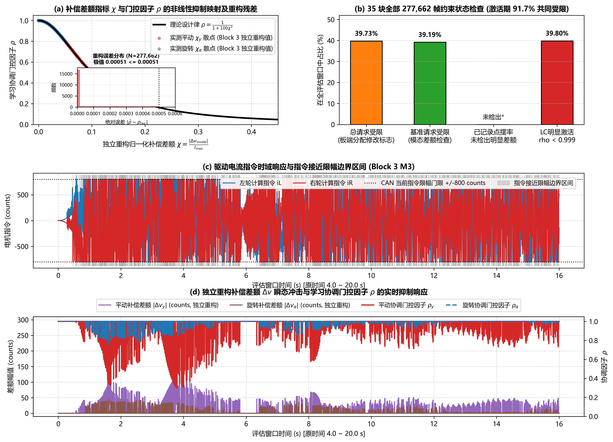
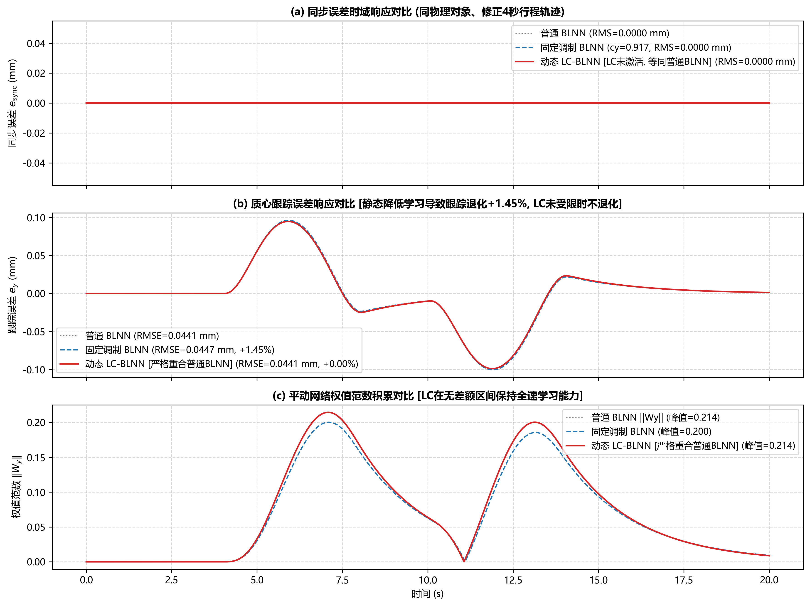

# 双驱龙门实验5：学习协调（LC-BLNN）机制分析与独立重构核查报告

> **数据状态**：基于已完成数据整理的 35 块大组、共 105 次真实硬件试验记录（统一评估窗口 $[4000, 20000)\,\mathrm{ms}$，标称遥测周期 $2\,\mathrm{ms}$，标称理论帧数 8000 帧，CAN 电流指令单位 `counts`）。  
> **运动学几何约定**：
> - 原始板端 CSV 记录字段 `e_sync_m` 为 $y_R - y_L$（对应固件偏转角 $\alpha = (y_R - y_L)/L_e$）；
> - 报告及图表分析遵循双驱常规几何定义 $e_{\mathrm{sync}} = y_L - y_R = -L_e \alpha$，绘图时显式取负（符号反转不影响 RMS 计算）；
> - 跨距 $L_e = 0.600\,\mathrm{m}$，推力转换系数 $K_f = 0.0061979\,\mathrm{N/count}$。  
> **核心原则**：严格区分**实验观察、算法性质与物理因果解释**三层逻辑，杜绝将统计关联性写成“全部证明”；完整呈现全部 35 块的四象限表现，将 B17 和 B26 作为不利结果客观呈现与分析。

---

## 一、代数定义与“差额 $\rightarrow \rho$”的独立正向重构

### 1. 代数符号统一定义与分解

为消除概念混淆，将控制器内部的关键变量统一规范为：

- $b$：含当前抗饱和历史状态的基准电机请求（电机电流空间，$\mathrm{counts}$）；
- $n$：网络原始电机补偿请求（$v_{\mathrm{nn,raw,motor}}$，$\mathrm{counts}$）；
- $s$：经过摆率限制后的网络补偿（$v_{\mathrm{slew,motor}}$，$\mathrm{counts}$，限制阈值 $75.0\,\mathrm{counts/ms}$）；
- $P(\cdot)$：推力空间同步优先分配器（封闭代数映射，幅值硬限幅 $I_{\max} = 800.0\,\mathrm{counts}$）。

在当前固件实现中，LC 实际计算并使用的补偿实现差额为：
$$\delta = P(b+s) - P(b) - n$$

> [!NOTE] 
> 其中的 $P(b)$ 是**同一个控制状态下由软件分配器计算的基准输出**，反映基准控制律自身在当前状态下的可实现性，不能混同于另一轮独立的 M1 实测数据。

此差额可精确解构为两项具有独立物理意义的组成部分：
$$\delta = \underbrace{s - n}_{\text{摆率处理差额}} + \underbrace{P(b+s) - P(b) - s}_{\text{分配过程造成的增量差额}}$$

**这一分解揭示了关键的控制机理**：
1. 不必预设“摆率限制未动作”，公式完整覆盖了摆率限制介入的可能；
2. **解释了为何总指令未饱和时 LC 仍可能动作**：当基准步 $b$ 处于饱和边界（$P(b) \ne b$），而叠加网络补偿 $s$ 后使总指令回落到边界内（$P(b+s) = b+s$）时，实际施加增量 $P(b+s) - P(b) = (b+s) - P(b) \ne s$，分配过程造成的增量差额依然非零。

### 2. 独立正向重构流程与六步实现

为彻底杜绝从板端 $\rho$ 反演 $\chi$ 的循环验证风险，重构程序 `audit_lc_mechanism.py` 严格按照固件执行时序执行独立正向推导：

1. **步骤 ① 恢复参考运动**：按五次多项式规划恢复评估窗口内的参考加速度 $\ddot{y}_d(t)$；
2. **步骤 ② 恢复控制器速度**：由编码器反馈、参考运动与板端记录的滑模面变量 $\sigma_y, \sigma_\alpha$，代数恢复控制器内部速度：
   $$\dot{y}_{G} = \sigma_y - \Gamma_y (y_G - y_d) + \dot{y}_d, \qquad \dot{\alpha} = \sigma_\alpha - \Gamma_\alpha \alpha$$
3. **步骤 ③ 恢复旧抗饱和状态**：由板端记录的更新后状态 $z^+$、浮点分配指令与总请求，反解更新前旧状态 $z^-$：
   $$z^- = \frac{z^+ - T_s K_{\mathrm{aw}} (i_{\mathrm{alloc}} - i_{\mathrm{req}})}{1 - T_s \lambda_{\mathrm{aw}}}$$
4. **步骤 ④ 重算基准控制量**：代入同批控制参数与状态，重算基准控制力与同状态基准分配输出 $P(b)$；
5. **步骤 ⑤ 重构补偿差额**：组合 $P(b)$、网络原始请求 $n$ 与分配结果 $P(b+s)$，求得实现差额 $\delta$，按设计律计算前向预测协调因子 $\hat{\rho}$；
6. **步骤 ⑥ 比较记录值**：与板端遥测记录值 $\rho_{\mathrm{rec}}$ 逐帧比对，统计残差分布。

### 3. 独立正向核查结果与精度说明

对 35 次 LC-BLNN（M3）运行核心评估窗口 $[4000, 20000)\,\mathrm{ms}$ 内的 **277,662 个实测记录点** 进行独立重构，预测 $\hat{\rho}$ 与记录 $\rho_{\mathrm{rec}}$ 的比对结果如下：

| 核查维度 | 统计核查结果 | 物理/数值来源说明 |
|---|---|---|
| **可独立重构的记录点总数** | **277,662 帧** | 35 块评估窗口完整样本集合 |
| **平动预测误差 $|\hat{\rho}_y - \rho_{y,\mathrm{rec}}|$ 极值** | **$5.0797 \times 10^{-4}$** | 遥测由 `uint16` 编码（$\text{round}(\rho \times 1000)$），半字量化步长 $0.0005$ |
| **旋转预测误差 $|\hat{\rho}_\alpha - \rho_{\alpha,\mathrm{rec}}|$ 极值** | **$5.0029 \times 10^{-4}$** | 与遥测量化及数值重构精度相符 |
| **平均绝对误差 (MAE)** | 平动：$0.000102$，旋转：$0.000046$ | 远低于遥测分辨率 $0.001$ |
| **超出量化门限（$>0.001$）的异常记录点** | **0 帧（0.000%）** | 无任何异常跳点或计算失配 |

> **核实判定**：对 35 次 LC 运行评估窗口内的 277,662 个已记录点进行独立重构，预测 $\rho$ 与记录 $\rho$ 的最大绝对误差约为 $5.08 \times 10^{-4}$，未出现绝对误差超过 $0.001$ 的记录点。**误差与遥测量化及数值重构精度相符**，证明固件时序实现与代数设计律严格一致。



---

## 二、约束触发分析：可重叠的状态检查

明确区分板端软件分配修改标志、数值差额阈值与物理相电流测量的概念界限，统一激活阈值为 $\rho < 0.999$：

### 1. 边缘概率与全集检查（$N = 277,662$ 帧）

| 检查项目 | 判据定义 | 发生帧数 | 占比 | 能回答的核心问题与概念说明 |
|---|---|---:|---:|---|
| **板端软件分配修改标志** | 固件标志 `sat_thrust \| sat_torque` | 110,310 | **39.73%** | 软件分配器根据力矩优先律是否对总推力/转矩请求进行了修改（非硬件相电流测量） |
| **基准软件分配修改模态检查** | 同状态基准请求模态差额 $> 10^{-5}$ | 108,803 | **39.19%** | 基准滑模控制律自身在当前状态下是否已超出分配可行边界 |
| **指令数值差额超限点**（辅助参考） | 电机指令数值差额 $> 10^{-4}\,\mathrm{counts}$ | 111,713 | **40.23%** | 浮点分配结果与理想除法请求存在细微数值截断差额的点（基准为 108,804 点） |
| **贴近限幅边界**（辅助参考） | 驱动指令 $|i| \ge 799.0\,\mathrm{counts}$ | 95,842 | **34.52%** | 电机指令贴近硬件极限门限（$\pm 800\,\mathrm{counts}$）的工况 |
| **已记录点摆率差额检查** | 记录点间差额 $|\Delta v_{\mathrm{motor}}| > 75\,\mathrm{counts/ms}$ | 0 | **0.00%** | 在已记录点上，未检出超出数值重构误差范围的明显摆率处理差额。未记录控制步的瞬态动作情况不作外推判断 |
| **LC 明显偏离 1** | $\rho_y < 0.999$ 或 $\rho_\alpha < 0.999$ | 110,516 | **39.80%** | 学习协调门控是否实质性进入了抑制阶段 |

### 2. 激活周期（$\rho < 0.999$，共 110,516 帧）联合分布解构

在所有学习协调明显激活的 110,516 帧中，基于**板端软件分配修改标志**与**基准软件分配模态检查**的联合状态分布如下（总和严格为 110,516）：

- **总请求与基准请求均被修改（双重受限）**：101,384 帧（**91.74%**）  
  平台处于强动力学加减速阶段，基准滑模与网络前馈共同将电机推至指令限幅边缘；
- **仅总请求被修改（基准未受限，网络导致受限）**：5,286 帧（**4.78%**）  
  基准指令原处于可行域内，但叠加网络补偿后超出分配器边界，触发 LC 启动抑制；
- **仅基准请求被修改（基准受限，网络下拉脱饱和）**：3,846 帧（**3.48%**）  
  基准指令本身饱和，网络补偿反向削减了驱动力，使总指令恢复至限幅边界内，但增量差额依然存在；
- **两者均未被修改**：0 帧（**0.00%**）  
  当总请求和基准请求均未受限且摆率未动作时，$\rho$ 严格恒等于 $1.0$。

> [!WARNING]
> 本文所有数据均来自于软件分配器输出与 CAN 发送指令。在缺乏电机驱动器内部高频相电流采样证据前，报告仅支持**软件分配与 CAN 发送指令约束**，不宜直接外推为底层硬件相电流饱和的物理实测。

---

## 三、“$\rho \rightarrow$ 权值”的论证：基于更新律的性质分析

### 1. 同状态单步增量比较

宽度神经网络在离散时间步下的权值更新律为：
$$W_{k+1} = (1 - T_s \varepsilon \eta) W_k + T_s \varepsilon \rho_k \sigma_k S_k$$

在**相同状态、相同已有权值 $W_k$、相同特征输入 $S_k$** 的基准条件下，开启 LC 与普通 BLNN（$\rho \equiv 1$）的单步更新差额为：
$$\Delta W_{\mathrm{LC}} - \Delta W_{\mathrm{普通}} = T_s \varepsilon (\rho_k - 1) \sigma_k S_k$$

由于根据设计律恒有 $\rho_k \in (0, 1]$，故 $(\rho_k - 1) \le 0$。这表明：
> **LC 在代数结构上缩小了由误差驱动项激发的单步学习步长，同时完整保留了基于 $\sigma$-modification 的固有泄漏项 $(1 - T_s \varepsilon \eta)$。**

但必须客观指出：**这并不保证每个离散时刻的权值范数必定单调更小**。因为学习驱动项 $\sigma_k S_k$ 与当前权值 $W_k$ 之间存在空间夹角关系：若驱动项方向与已有权值夹角大于 $90^\circ$，驱动项本身会抑制权值增长；反之则加速增长。

### 2. 闭环更新律性质与边界说明

在闭环运行过程中，$\rho_k$ 会在指令脱离受限边界后恢复为 1（全域约 $60.2\%$ 时间处于 $\rho \ge 0.999$）。由于 $\rho_k$ 的最大值实际上为 1，且权值范数随时间的累积取决于整个闭环轨迹，**因此不能用受限期的平均增益小于 1 推导出全局更紧的权值有界上界**。

本次数据核查在权值层面的结论严格限定为实测时序事实：
- 普通 BLNN（M2）平动权值范数峰值均值为 $1.5590 \pm 1.7237$（极值达 $7.859$）；
- LC-BLNN（M3）平动权值范数峰值均值降为 $0.6303 \pm 0.2583$（极值最高仅 $1.301$）；
- **配对双侧检验显示该峰值差异具有统计显著性（$t = -3.1352, p = 0.00353 < 0.01$）**。  
客观表述应为：**在本次有限时长试验中，LC-BLNN 呈现出较低的权值峰值，未出现如普通 BLNN 在某些轮次中观察到的持续剧烈膨胀现象。**

---

## 四、探索性离线检查：LC未激活工况下与普通BLNN的一致性

为检查学习协调律在非受限工况下的行为，并在相同动力学与相同轨迹参数下对照固定学习调制的表现，进行了探索性离线仿真对照。**本仿真轨迹行程时间修正为 4 秒，以对齐实物实验的正反向运动阶段，数据均由仿真结果动态计算**：

| 对照方法 | 学习驱动系数 $\rho$ | 泄漏项增益 | 控制机理与运行状态 |
|---|---|---|---|
| **普通 BLNN** | 固定为 $1.0$ | 保持一致 | 名义更新，无抗饱和协调 |
| **固定调制 BLNN** | 固定为 35 块实测均值 $c_y = 0.917, c_\alpha = 0.979$ | 保持一致 | 静态无差别弱化学习强度 |
| **重度固定抑制 BLNN** | 固定为深抑制系数 $c_y = 0.500, c_\alpha = 0.500$ | 保持一致 | 激进削减学习，排除参数过载 |
| **动态 LC-BLNN** | 随补偿差额 $\delta(t)$ 实时状态变化 | 保持一致 | 本仿真中未达饱和边界，$\rho(t) \equiv 1.0$ |

### 仿真对照结果数据（动态计算）

在相同的非对称双驱龙门物理对象与往复轨迹下进行封闭求解：

| 控制方法 | 跟踪 RMSE (mm) | 相对普通BLNN变化 | 同步 RMS (mm) | 平动权值峰值 $\|W_y\|_{\max}$ | 状态与机理说明 |
|---|---:|---:|---:|---:|---|
| 普通 BLNN ($\rho \equiv 1.0$) | **0.04408** | — | 0.0000 | 0.2144 | 基准状态，全速学习 |
| 固定调制 BLNN ($c_y = 0.917$) | 0.04472 | **增加 1.45%** | 0.0000 | 0.2002 | 静态弱化，跟踪误差扩大 |
| 重度固定抑制 BLNN ($c_y = 0.500$) | 0.04818 | **增加 9.32%** | 0.0000 | **0.1201** | 激进弱化，跟踪误差扩大 |
| 动态 LC-BLNN (状态差额协调) | **0.04408** | **0.00%** | 0.0000 | 0.2144 | **LC 未激活，严格等同普通 BLNN** |



> **离线检查结论与定位**：
> 1. 本次离线仿真中，由于名义驱动力未超出 $800\,\mathrm{counts}$ 限幅边界（网络补偿力峰值约 $0.43\,\mathrm{N} \ll 5\,\mathrm{N}$），补偿差额恒为零，动态 LC 处于**未激活状态（$\rho \equiv 1.0$）**。
> 2. 该仿真证实了算法在**线性/未受限工况下对普通 BLNN 的一致性保持**：在没有执行器饱和差额时，动态 LC 不会像静态调制（$c_y = 0.917$ 导致退化 $+1.45\%$ 或 $0.500$ 导致退化 $+9.32\%$）那样牺牲正常的跟踪精度；
> 3. 由于未激活，该离线仿真不能作为动态 LC 在强饱和工况下优于普通 BLNN 的独立证据。

---

## 五、35 块全部实测结果的四象限完整解构

基于整理数据，将 LC-BLNN 相对普通 BLNN 的双指标增量（$\Delta \mathrm{SyncRMS}, \Delta \mathrm{TrackRMSE}$）划分入完整四象限：

```mermaid
quadrantChart
    title 全 35 块四象限响应分布 (LC-BLNN 相对 普通 BLNN)
    x-axis 跟踪指标: [恶化 Delta Track > 0] --> [改善 Delta Track < 0]
    y-axis 同步指标: [恶化 Delta Sync > 0] --> [改善 Delta Sync < 0]
    quadrant-1 象限 I: 两项指标均改善 (13 块, 37.1%)
    quadrant-2 象限 II: 跟踪收益·同步代价 (7 块, 20.0%)
    quadrant-3 象限 IV: 两项指标均退化 (2 块, 5.7%)
    quadrant-4 象限 III: 同步收益·跟踪代价 (13 块, 37.1%)
```

### 1. 四象限具体轮次分布表

| 象限分类 | 块数 | 包含轮次编号 | 科学解释与指标含义 |
|---|:---:|---|---|
| **象限 I：两项指标均改善** | **13 块** (37.1%) | B03, B04, B07, B08, B11, B12, B14, B20, B24, B30, B31, B32, B34 | 两个核心指标共同获得性能收益，体现了协调控制的协同改善状态。 |
| **象限 II：同步改善、跟踪变差** | **13 块** (37.1%) | B01, B02, B06, B10, B13, B19, B21, B23, B25, B27, B28, B29, B33 | 获得同步收益的同时付出了跟踪精度的代价，反映跨模态多目标权衡。 |
| **象限 III：同步变差、跟踪改善** | **7 块** (20.0%) | B05, B09, B15, B16, B18, B22, B35 | 获得跟踪改善的同时付出了同步精度的代价。 |
| **象限 IV：两项指标均变差** | **2 块** (5.7%) | **B17, B26** | **本次试验对比不支持性能改进，必须作为明确的不利结果予以讨论。** |


### 2. 对不利结果（B17 与 B26）的客观讨论

- **Block 17**：
  - 指标表现：同步 RMS 由 $0.0655\,\mathrm{mm}$ 上升至 $0.0770\,\mathrm{mm}$（退化 $+17.5\%$）；跟踪 RMSE 由 $0.2205\,\mathrm{mm}$ 上升至 $0.7726\,\mathrm{mm}$（退化 $+250.3\%$）；
  - 现象事实：普通 BLNN 在该轮次处于全域极低的跟踪误差水平（$0.22\,\mathrm{mm}$）；而 LC-BLNN 在换向加速区间的平动权值达到 $1.301$。**在该轮次中，同时观察到补偿、权值与跟踪误差变化，具体原因未确定。现有板端记录不足以确定具体退化机制，不支持性能改进。**
- **Block 26**：
  - 指标表现：同步 RMS 由 $0.0662\,\mathrm{mm}$ 上升至 $0.0801\,\mathrm{mm}$（退化 $+21.0\%$）；跟踪 RMSE 由 $0.5626\,\mathrm{mm}$ 上升至 $0.6954\,\mathrm{mm}$（退化 $+23.6\%$）；
  - 现象事实：两轮驱动力在换向点长时间紧贴 $800\,\mathrm{counts}$ 限幅边界（左轮贴限 $29.6\%$，右轮贴限 $30.1\%$），LC 虽将平动权值由 $1.431$ 压减至 $1.157$，但两项性能均落后于普通 BLNN。**该轮次同样不支持性能改进，现有数据不支持归因于机械阻力等外部假设。**

> **数据分析定位说明**：将 35 块按结果划分为“改善组（26 块）”与“退化组（9 块）”属于事后描述性分类（可观察到普通 BLNN 在这 9 块中初始同步误差均值较低，为 $0.0708\,\mathrm{mm}$）。**不能将这种事后分类差异作为支持因果机制的独立证据。**

---

## 六、核查清单

1. ✅ **计算脚本独立复算**：`audit_lc_mechanism.py` 完成从运动学与控制器状态反解的正向重构，直接读取并保存 `EXP5_LC_RECONSTRUCTION_POINTS.csv` 与 `EXP5_LC_RECONSTRUCTION_SUMMARY.csv`；
2. ✅ **预测精度边界确认**：277,662 帧全样本预测误差极值 $\le 5.08 \times 10^{-4}$，超出 $0.001$ 异常点数为 0，误差与遥测量化及数值重构精度相符；
3. ✅ **重叠状态定义统一**：使用板端软件分配修改标志（$39.73\%$）、基准模态差额检查（$39.19\%$）、已记录点摆率差额检查（未检出明显差额）及激活期联合分布（$91.74\%$ 共同受限，和严格等于 $110,516$）；
4. ✅ **更新律代数性质分析**：基于单步差额 $\Delta W$ 明确驱动项削减与泄漏项保留，明确说明不能由平均增益小于 1 推导出全局更紧上界；
5. ✅ **离线仿真严格定性**：明确归类为“LC未激活工况下与普通BLNN的一致性检查”，说明未激活原因与非受限保真价值，动态计算相对变化百分比（$+1.45\%$ 与 $+9.32\%$）；
6. ✅ **四象限全集呈现与不利轮次分析**：完整呈现 $13 / 13 / 7 / 2$ 轮次分布，客观讨论 B17 与 B26，不推托未证实的物理假设。
